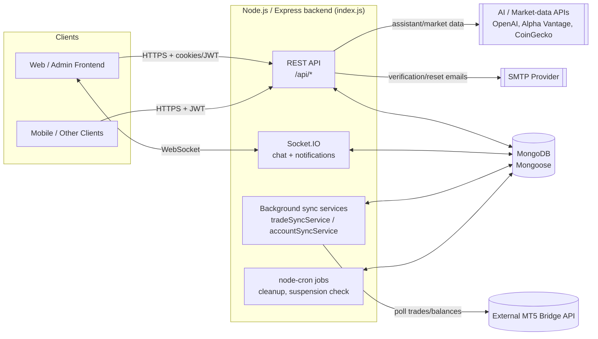
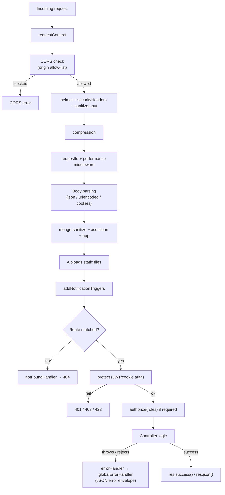
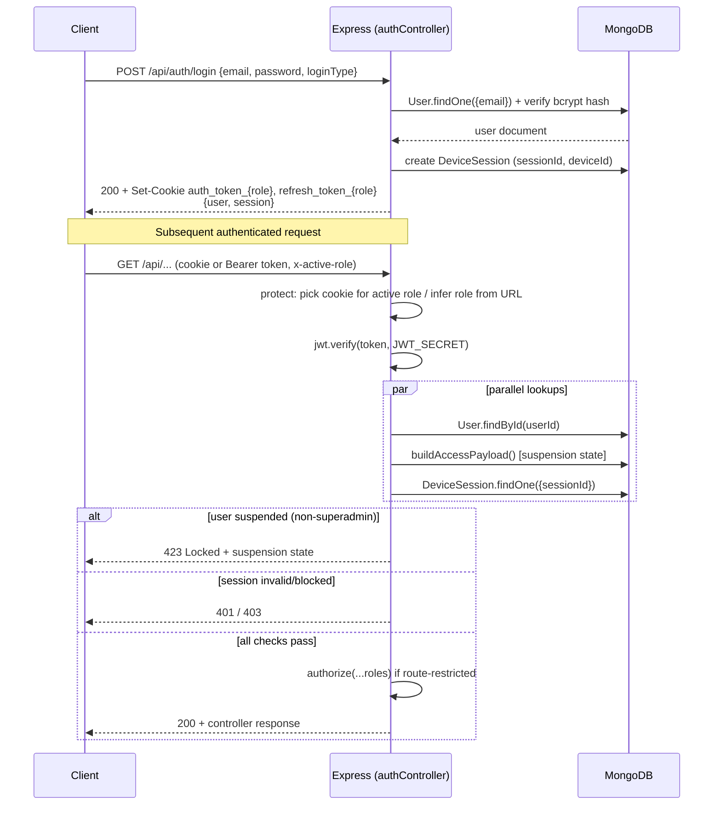
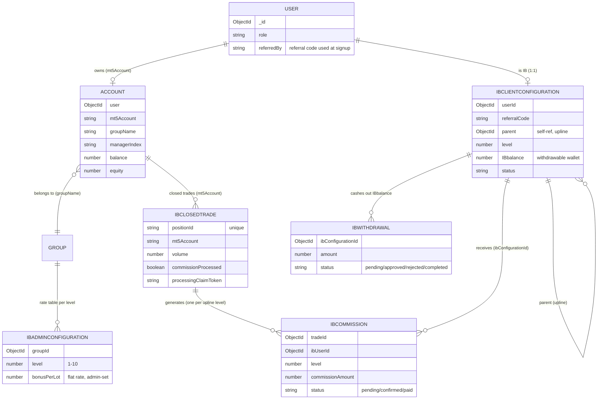
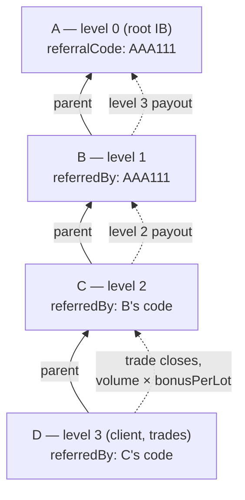
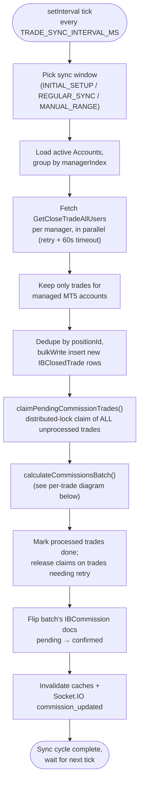
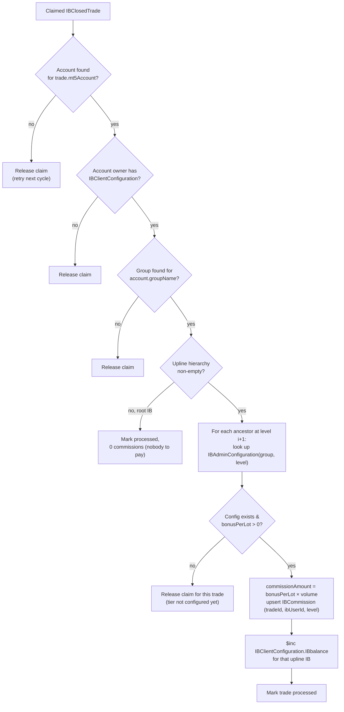
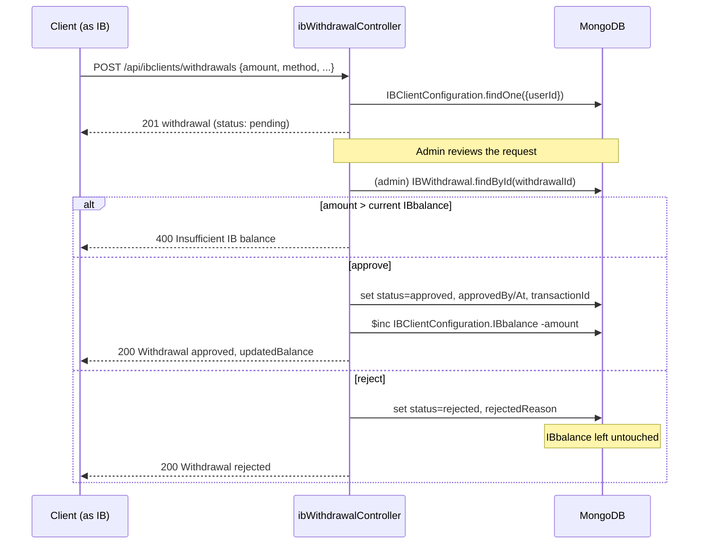

# Backend Documentation — New Demo CRM

This note explains how the backend works, what it needs to run, and what its
API responses look like. It reflects the code as it exists in this repo
(`index.js` as the entry point).

---

## 1. What this backend is

A **Node.js + Express + MongoDB (Mongoose)** REST API for a Forex/Trading CRM.
It manages:

- Client/Admin/Agent/Superadmin **authentication** (JWT, cookie-based, multi-role)
- **Trading accounts** (MT5 accounts), deposits, withdrawals, transfers
- **IB (Introducing Broker) / Partner** commissions and referral trees
- **Copy trading** (masters, copiers, ratings)
- **Support tickets** with real-time chat (Socket.IO)
- **Notifications** (in-app + email)
- **Admin dashboards** and **revenue analytics**
- Background **sync services** that pull trade/account data from an external
  MT5 API on a schedule

Tech stack:

| Layer | Technology |
|---|---|
| Runtime | Node.js, Express 4 |
| Database | MongoDB via Mongoose 8 |
| Auth | JWT (`jsonwebtoken`) + httpOnly cookies, bcrypt/bcryptjs password hashing |
| Realtime | Socket.IO (chat + notifications) |
| Validation | Joi (+ some Zod) |
| Security | helmet, express-mongo-sanitize, xss-clean, hpp, express-rate-limit, cors |
| Scheduled jobs | node-cron |
| Email | nodemailer |
| File uploads | multer / express-fileupload |
| Docs/exports | exceljs, pdfkit, docx, node-xlsx |
| Logging | winston + morgan |
| Metrics | prom-client |

### 1.1 High-level architecture



---

## 2. How a request flows through the server

`index.js` wires everything through a `Server` class:

1. **`requestContext`** — attaches a request-scoped context (used for error tracking).
2. **CORS** — dynamic per-request origin check against `ALLOWED_ORIGINS` env var,
   `CLIENT_URL`, and a hardcoded list of production/dev origins. Credentials
   (cookies) are allowed. Custom headers `Authorization`, `x-active-role`,
   `x-device-id`, `x-device-name` are permitted.
3. **`helmet`** — sets security headers + a Content-Security-Policy.
4. **`securityHeaders`, `sanitizeInput`** — custom hardening middleware.
5. **`compression`** — gzip, skipped for image/video/audio/zip/pdf responses.
6. **`requestIdMiddleware` / `performanceMiddleware`** — tags each request with
   an ID and times it (Prometheus-style metrics).
7. **Body parsing** — `express.json` / `urlencoded`, 10MB limit; `cookieParser`.
8. **`express-mongo-sanitize`, `xss-clean`, `hpp`** — strips NoSQL-injection
   payloads, XSS strings, and duplicate HTTP-parameter pollution.
9. **Static files** — `/uploads/*` served with `Access-Control-Allow-Origin: *`.
10. **`addNotificationTriggers`** — hooks that fire notification events off
    certain requests.
11. **Route handlers** (see §4).
12. **`notFoundHandler` → `errorHandler` → `globalErrorHandler`** — in that
    order, so any thrown/rejected error ends up JSON-formatted (see §6).



The server also:
- Opens a **Socket.IO** server on the same HTTP server (`utils/socketServer.js`)
  for chat + live notifications, authenticated via the same JWT/cookie scheme.
- Runs **4 cron jobs**: notification cleanup (2 AM daily), session cleanup
  (hourly), log rotation (midnight), and billing-suspension evaluation (9 AM
  daily).
- Starts two background **sync services** on boot (`tradeSyncService`,
  `accountSyncService`) that poll an external MT5 API and mirror trades/account
  balances into MongoDB.
- Handles **graceful shutdown** on `SIGTERM`/`SIGINT`: stops accepting
  connections, drains sync services, then exits.

---

## 3. What the backend requires to run

### 3.1 Required environment variables (`.env`)

Hard requirement (server throws on `validateConfig()` if missing):
- `MONGO_URI` — MongoDB connection string
- `JWT_SECRET` — signing secret for access tokens

Everything else has a fallback or is optional, but functionally important:

| Category | Variables |
|---|---|
| Server | `PORT`, `NODE_ENV`, `CLIENT_URL`, `SERVER_URL`, `ALLOWED_ORIGINS` |
| Auth/JWT | `JWT_SECRET`, `JWT_EXPIRE`, `JWT_REFRESH_SECRET`, `JWT_REFRESH_EXPIRE` |
| Mongo tuning | `MONGO_MIN_POOL_SIZE`, `MONGO_MAX_POOL_SIZE`, `MONGO_COMPRESSORS`, `DEBUG_DB_QUERIES` |
| Email | `EMAIL_SERVICE`, `SMTP_HOST`, `SMTP_PORT`, `SMTP_USER`, `SMTP_PASS`, `EMAIL_FROM`, `ADMIN_EMAIL`, `COMPANY_NAME`, `COMPANY_EMAIL`, `EMAIL_BATCH_SIZE`, `EMAIL_RATE_LIMIT`, `EMAIL_MAX_RETRIES`, `EMAIL_RETRY_DELAY`, `EMAIL_QUEUE_ENABLED`, `TEST_EMAIL_ON_START` |
| MT5 / external trading API | `MT5_API_URL`, `MT5_API_KEY`, `MANAGER_INDEX`, `MANAGER_INDEXES`, `MAX_CONCURRENT_MANAGERS` |
| Trade/account sync | `ENABLE_TRADE_SYNC`, `ENABLE_ACCOUNT_SYNC`, `ENABLE_AUTO_SYNC`, `ENABLE_DAILY_SYNC`, `ENABLE_CLEANUP`, `ENABLE_HEALTH_CHECK`, `TRADE_SYNC_INTERVAL_MS`, `SYNC_INTERVAL_MS`, `ACCOUNT_SYNC_INTERVAL_MS`, `AUTO_SYNC_RANGE_HOURS`, `DAILY_SYNC_RANGE_HOURS`, `MAX_MANUAL_SYNC_RANGE_HOURS`, `INITIAL_SYNC_DAYS`, `REGULAR_SYNC_DAYS`, `RUN_INITIAL_SYNC`, `FORCE_FULL_SYNC`, `SYNC_BATCH_SIZE`, `TRADE_BATCH_SIZE`, `MAX_RETRIES`, `RETRY_DELAY_MS`, `PROCESSING_INTERVAL_MS`, `INITIAL_PROCESSING_DELAY_MS`, `STALE_ACCOUNT_THRESHOLD_MS` |
| Cron schedules | `CRON_AUTO_SYNC`, `CRON_DAILY_SYNC`, `CRON_ACCOUNT_SYNC`, `CRON_CLEANUP`, `CRON_HEALTH_CHECK` |
| Commission / IB | `COMMISSION_BATCH_SIZE`, `MAX_IB_DEPTH` |
| AI / assistant | `AI_PROVIDER`, `AI_API_URL`, `AI_API_KEY`, `OPENAI_API_KEY`, `OPENAI_MODEL`, `GROQ_API_KEY` |
| Market data | `ALPHA_VANTAGE_API_KEY`, `COINGECKO_DEMO_API_KEY` |
| Copy trading | `COPY_API_URL` |
| Misc | `DATA_RETENTION_DAYS`, `TIMEZONE`, `API_TIMEOUT_MS`, `CACHE_TTL_MS`, `DEBUG_MODE`, `ALERT_WEBHOOK_URL`, `ERROR_WEBHOOK_URL` |

### 3.2 Infrastructure dependencies
- A reachable **MongoDB** instance (Atlas or self-hosted).
- Network access to the external **MT5 trading API** (`MT5_API_URL`) for
  account/trade sync — the app still boots without it, but sync services log
  failures.
- An **SMTP** provider for verification/reset/notification emails.
- Write access to local `uploads/` (KYC docs, ticket attachments) and `logs/`.

### 3.3 Install & run
```bash
npm install
npm start              # nodemon index.js
npm run create:indexes # build MongoDB indexes
npm run audit:indexes  # check index usage
npm run analyze:performance
npm run optimize:db    # indexes + perf analysis
npm run seed-notifications
```
Default port: `3000` (config fallback) — `.env` currently sets its own `PORT`.

---

## 4. API surface (mounted routers)

All routes are prefixed with `/api`. Three routers are mounted directly on
`app` (no `/api` prefix logic needed, they already include it): health, sync
status, service status.

| Base path | Purpose |
|---|---|
| `GET /api/health` | Liveness probe (DB/email/websocket status) |
| `GET /api/sync/status` | Trade/account sync service status |
| `GET /api/status` | Full service status incl. memory/CPU |
| `/api/auth` | Signup, login, logout, refresh, email verification, password reset, impersonation |
| `/api/leverages`, `/api/groups`, `/api/payment-methods`, `/api/app-settings`, `/api/exchanges` | Reference/config data (admin-managed) |
| `/api/accounts` | Client trading accounts (MT5) |
| `/api/clientdeposits`, `/api/admindeposits` | Client-side and admin-side deposit workflows |
| `/api/withdrawals`, `/api/adminwithdrawals` | Client and admin withdrawal workflows |
| `/api/transfers`, `/api/transactions` | Internal transfers, transaction history |
| `/api/profile` | Client profile management |
| `/api/clients`, `/api/admin/clients` | Admin client management (KYC, listing, search) |
| `/api/admin/transactions` | Admin transaction oversight |
| `/api/ib-configurations`, `/api/ibclients/ib-configurations` | IB/partner commission configuration (admin + client sides) |
| `/api/ibclients/withdrawals`, `/api/admin/ib-withdrawals` | IB commission withdrawals |
| `/api/ibclients/commission` | Client commission ledger |
| `/api/admin/partners` | Partner directory, referral tree, commission totals |
| `/api/admin/dashboard`, `/api/client/dashboard` | Aggregated dashboard stats |
| `/api/admin/revenue-analytics` | Revenue analytics |
| `/api/superadmin` | Superadmin-only operations |
| `/api/trading` | Trading data endpoints |
| `/api/daily-performance` | Daily P&L / performance stats |
| `/api/client/statement` | Account statements (export) |
| `/api/otp` | OTP generation/verification |
| `/api/copy`, `/api/copy-trade`, `/api/copy-rating`, `/api/copy-copier` | Copy-trading system |
| `/api/tickets` | Support ticket + chat threads |
| `/api/notifications` | In-app notifications |
| `/api/client/assistant` | AI assistant integration |

---

## 5. Authentication & authorization model

- **Roles**: `client`, `admin`, `superadmin`, `agent` (single `User` model,
  `role` field discriminates).
- **Multi-role sessions**: cookies are role-scoped —
  `auth_token_client`, `auth_token_admin`, `auth_token_superadmin`,
  `auth_token_agent` (plus a legacy generic `auth_token`), so the same browser
  can hold separate sessions per role simultaneously. The `x-active-role`
  header tells the backend which role's cookie to use for a given request.
- **Access token**: JWT, 1‑hour cookie (`ACCESS_COOKIE_MAX_AGE`), also
  accepted via `Authorization: Bearer <token>` header.
- **Refresh token**: JWT, 30‑day cookie, exchanged via `POST /api/auth/refresh`.
- **Device sessions**: each login creates a `DeviceSession` record
  (device fingerprint, IP, browser/OS, trust flag). The `protect` middleware
  re-validates the session on every request — it can reject with 401 for a
  missing/expired session, a device-ID mismatch, or 403 if the device was
  blocked by an admin.
- **Suspension check**: `protect` also loads a system-wide billing/maintenance
  "suspension" state (`suspensionService.buildAccessPayload`) and returns
  **423 Locked** for any non-superadmin if the platform is suspended.
- **Impersonation**: admins/superadmins can impersonate a client
  (`POST /api/auth/admin/impersonate/:clientId`); the resulting JWT carries
  `impersonatedBy` and bypasses the active-role mismatch check.
- **`authorize(...roles)`** middleware gates routes by role after `protect`.
- Passwords are hashed with bcrypt (cost factor 12) via a Mongoose `pre('save')`
  hook; email-verification and password-reset use SHA‑256-hashed random tokens
  with expiries.



Auth endpoints (`routes/authRoutes.js`):

| Method & path | Access | Notes |
|---|---|---|
| `POST /api/auth/signup` | Public | Joi-validated, creates client, sends verification email |
| `POST /api/auth/admin/signup` | superadmin | Creates an admin |
| `POST /api/auth/agent/signup` | admin, superadmin | Creates an agent |
| `GET /api/auth/verify-email/:token` | Public | Confirms email |
| `GET /api/auth/me` | Authenticated | Returns current user + suspension state |
| `POST /api/auth/check-verification-status` | Public | |
| `POST /api/auth/resend-verification` | Public | |
| `POST /api/auth/forgot-password` / `reset-password` | Public | |
| `POST /api/auth/admin/impersonate/:clientId` | admin, superadmin | |
| `POST /api/auth/login` | Public | Joi-validated, role-based (`loginType`), sets cookies |
| `POST /api/auth/refresh` | Public (needs refresh cookie) | |
| `POST /api/auth/check-role` | Public | |
| `POST /api/auth/logout` | Authenticated | |

---

## 6. Response shapes ("what response looks like")

The API is consistent about wrapping JSON in a `success` envelope, though the
exact shape differs slightly by helper used.

### 6.1 Success — `res.success()` (via `responseFormatter` middleware)
```json
{
  "success": true,
  "message": "Success",
  "data": { "...": "..." },
  "timestamp": "2026-07-23T10:00:00.000Z"
}
```

### 6.2 Success — paginated (`res.paginated()` / `paginate` middleware)
Two slightly different pagination shapes exist in the codebase (legacy vs.
newer helper) — check which one a given controller uses:
```json
{
  "success": true,
  "message": "Success",
  "data": [ ],
  "pagination": {
    "page": 1,
    "limit": 20,
    "total": 137,
    "pages": 7,
    "hasNext": true,
    "hasPrev": false
  },
  "timestamp": "2026-07-23T10:00:00.000Z"
}
```
or (older `middlewares/pagination.js` helper):
```json
{
  "success": true,
  "message": "Success",
  "data": [ ],
  "pagination": {
    "currentPage": 1,
    "totalPages": 7,
    "totalItems": 137,
    "itemsPerPage": 20,
    "hasNextPage": true,
    "hasPrevPage": false
  }
}
```

### 6.3 Auth-specific responses
Login (`POST /api/auth/login`) sets role-scoped cookies and returns:
```json
{
  "success": true,
  "message": "Login successful",
  "user": {
    "id": "665...",
    "firstname": "Jane",
    "lastname": "Doe",
    "email": "jane@example.com",
    "role": "client",
    "isEmailVerified": true
  },
  "session": {
    "sessionId": "uuid",
    "deviceId": "uuid",
    "isTrusted": false
  }
}
```

### 6.4 Errors — thrown `AppError` subclasses (`middlewares/errorHandler.js`)
Every controller wrapped in `asyncHandler` funnels thrown errors here. Shape:
```json
{
  "success": false,
  "errorId": "1753267200000-ab12cd3ef",
  "message": "Validation failed",
  "errorCode": "VALIDATION_ERROR",
  "errors": [ { "field": "email", "message": "\"email\" must be a valid email" } ],
  "timestamp": "2026-07-23T10:00:00.000Z"
}
```
Error classes and their default HTTP status / `errorCode`:

| Class | Status | errorCode |
|---|---|---|
| `ValidationError` | 400 | `VALIDATION_ERROR` |
| `AuthenticationError` | 401 | `AUTHENTICATION_ERROR` |
| `AuthorizationError` | 403 | `AUTHORIZATION_ERROR` |
| `NotFoundError` | 404 | `NOT_FOUND_ERROR` |
| `ConflictError` | 409 | `CONFLICT_ERROR` |
| `RateLimitError` | 429 | `RATE_LIMIT_ERROR` |
| `DatabaseError` | 500 | `DATABASE_ERROR` |
| `ExternalAPIError` | 502 | `EXTERNAL_API_ERROR` |

The handler also special-cases: Mongoose `ValidationError` (400, field list),
Mongo duplicate key `11000` (409), Mongoose `CastError` (400, bad ObjectId),
JWT `JsonWebTokenError`/`TokenExpiredError` (401), Multer file-size/count/field
errors (400), and Axios/network errors (proxies the upstream status).
In non-production, error responses additionally include `stack` for debugging;
in production the message is genericized to "An unexpected error occurred."

### 6.5 Session/device errors (from `protect` middleware)
```json
401 { "success": false, "message": "Not authorized Token  to access this route" }
401 { "success": false, "message": "Session not found. Please log in again." }
401 { "success": false, "message": "Session device mismatch. Please log in again." }
403 { "success": false, "message": "This device has been blocked. An administrator must mark it safe before you can use it again." }
423 { "success": false, "message": "...maintenance message...", "suspension": { } }
```

### 6.6 Rate limiting
`express-rate-limit` returns (429):
```json
{ "success": false, "message": "Too many requests, please try again later.", "errorCode": "RATE_LIMIT_EXCEEDED" }
```
Tiers: `auth` (5/15min), `sensitive` (10/hr), `api` (100/15min), `public` (500/15min).

---

## 7. Data model (Mongoose collections)

Root `models/`: `User`, `AppSetting`, `Attachment`, `Copy`, `Deposit`,
`DeviceSession`, `Exchange`, `Group`, `IBClosedTrade`, `IBCommission`,
`IBWithdrawal`, `Leverage`, `Message`, `Notification`, `PaymentMethod`,
`Ticket`, `withdrawal`.

`models/admin/`: `IBAdminConfiguration` (commission tier config).
`models/client/`: `Account` (MT5 trading account), `IBClientConfiguration`,
`profile`, `Transfer`.

Key `User` fields: `firstName`, `lastName`, `email` (unique, indexed),
`role` (`client|admin|superadmin|agent`), `password` (hashed, `select:false`),
`country.{name,state}`, `phone`, `dateofbirth`, `isEmailVerified`, `status`
(`activated|suspended`), `referredBy`, verification/reset token pairs,
`refreshToken`. Has a text index over name/email for client search.

Key `Account` fields: `user` (ref User), `mt5Account` (unique), `investor_pwd`,
`master_pwd`, `leverage`, `accountType`, `groupName`, `platform`, `balance`,
`equity`, `status` (bool), `managerIndex`. Heavily indexed for
per-user/status/type dashboard queries.

---

## 8. Realtime layer (Socket.IO)

`utils/socketServer.js` runs a Socket.IO server on the same HTTP server.
- Auth: token pulled from `socket.handshake.auth.token`, the
  `Authorization` header, or role-scoped cookies (same convention as REST),
  verified with the same `JWT_SECRET`.
- Used for: live support-ticket chat (`Ticket`/`Message` models) and pushing
  `Notification` events to connected clients in real time
  (`notificationService` / `notificationTriggers`).

---

## 9. Background services

| Service | What it does |
|---|---|
| `tradeSyncService` | Polls the external MT5 API for closed trades and mirrors them; drives IB commission calc. Self-scheduling via `setInterval`; exposes `getSyncStatus()`. See §10 for full detail. |
| `accountSyncService` | Polls MT5 for account balance/equity updates. Self-scheduling continuous loop. See §10. |
| `suspensionService` | Evaluates billing/maintenance suspension state; broadcast via Socket.IO when it changes; runs daily at 9 AM via cron. |
| `notificationService` / `notificationTriggers` / `notificationEmailService` | Creates in-app notifications and mirrors important ones to email. |
| `cacheService` | In-memory/short-TTL caching (e.g. auth lookups, commission/IB-config reads) to cut DB round trips. |
| `emailService` | SMTP sending for verification, password reset, transactional notices. |
| `assistantSentimentService` / `openaiAssistantService` | AI assistant features (uses `OPENAI_API_KEY`/`AI_API_KEY`). |
| `forexIntelligenceService` | Market data (Alpha Vantage / CoinGecko) for assistant/dashboard context. |
| `deviceSessionService` | Device/session trust and blocking logic used by `protect`. |
| `transactionService` | Shared transaction bookkeeping used by deposit/withdrawal/transfer flows. |
| `cronJobService` | A **second, unused** node-cron-based scheduler for the same sync/cleanup/health-check jobs — see §10.5. |

---

## 10. MT5 sync jobs & the IB commission engine (deep dive)

This is the most complex subsystem in the backend: it pulls closed trades and
account balances from an external MetaTrader 5 bridge API, then walks a
multi-level referral tree to pay "Introducing Broker" (IB) commissions per
lot traded.

### 10.1 The external MT5 API client

`API/metaApi.js` is a thin axios instance:
```js
axios.create({ baseURL: process.env.MT5_API_URL, headers: { "x-api-key": process.env.MT5_API_KEY } })
```
Two endpoints are called against it:
- `GET /GetCloseTradeAllUsers` — closed trades for a given `Manager_Index` and
  `StartTime`/`EndTime` window (used by trade sync).
- `POST /GetUserInfoByAccounts` — current balance/equity for a list of MT5
  account numbers under a given `Manager_Index` (used by account sync).

"Manager index" corresponds to a specific MT5 manager account/server the
external bridge exposes — a brokerage can run multiple MT5 servers/manager
credentials (`MANAGER_INDEXES`, comma-separated, default `"3"`), and accounts
are grouped by their own `Account.managerIndex` field so each manager's
trades/accounts are fetched separately (in parallel).

### 10.2 Data model that powers commissions

```
User (role: client)
  └─ Account (mt5Account, groupName, managerIndex, balance, equity)
User (1:1) ── IBClientConfiguration            ← the referral-tree node
                 { userId, referralCode, referredBy, parent → IBClientConfiguration,
                   level, status, IBbalance }
IBAdminConfiguration  { groupId → Group, level (1-10), bonusPerLot }
IBClosedTrade         { mt5Account, positionId (unique), volume, profit,
                        commissionProcessed, processingClaim* fields }
IBCommission          { tradeId, clientId, ibUserId, ibConfigurationId,
                        level, bonusPerLot, volume, commissionAmount, status,
                        batchId }   ← unique on (tradeId, ibUserId, level)
IBWithdrawal          { userId, ibConfigurationId, amount, status, ... }
```

- **`IBClientConfiguration.parent`** is a self-reference forming the referral
  tree: `level` is the node's depth (root sponsors are `level 0`), and walking
  `parent` pointers upward gives a user's chain of sponsors/upline.
- **`IBAdminConfiguration`** is the commission *rate table*: for a given
  trading `Group` (e.g. a specific account-type/symbol group) and a given
  upline `level` (1 = direct sponsor, 2 = sponsor's sponsor, up to 10 deep),
  it defines a flat **`bonusPerLot`** — a fixed currency amount paid per lot
  traded, *not* a percentage of profit. Admins configure this per group/level
  via `/api/ib-configurations` (`controllers/admin/ibAdminConfigurationController.js`).
- **`IBCommission`** is the ledger of individual payouts: one row per
  (trade, upline IB, level), enforced unique so the same trade can never pay
  the same IB twice at the same level even if reprocessed.



### 10.3 Referral-tree creation

`POST /api/ibclients/ib-configurations/create` (client, self-service — "become an IB"):
1. If the user already has a `pending` config, it's activated (a unique
   6-hex-char `referralCode` is generated via `crypto.randomBytes(3)` if one
   doesn't exist yet).
2. Otherwise a brand-new config is created. If the signing-up user had
   supplied a `referralCode` at signup (`User.referredBy`), that code is
   looked up in `IBClientConfiguration` to find the **parent** node; the new
   node's `level = parent.level + 1`. No referrer ⇒ `level = 0` (a root IB).
3. Downline listing (`getAllDownlinePartnersRecursive` in
   `commissionController.js`) uses a single MongoDB **`$graphLookup`**
   aggregation (self-join on `parent`) instead of recursive queries, to pull
   an IB's entire subtree in one round trip.

Example tree (each node is an `IBClientConfiguration`; arrows point from
child up to `parent`, i.e. "refers up to"). When client **D** places a trade,
commissions flow *up* the chain: **C** gets the level-1 rate, **B** the
level-2 rate, **A** the level-3 rate (each looked up from
`IBAdminConfiguration` for D's account's `Group`):



### 10.4 Trade sync — step by step (`services/tradeSyncService.js`)

Entry point `syncTrades()`, guarded by an `isProcessing` flag so overlapping
runs in the same process are skipped:



1. **Window selection** — `getSyncStartTime()`:
   - `INITIAL_SETUP` (first run): looks back `INITIAL_SYNC_DAYS` (default 365),
     but shortens the window if a trade already exists locally (starts 1 day
     before the newest stored `closeTime`).
   - `REGULAR_SYNC` (steady state): looks back `REGULAR_SYNC_DAYS` (default 1).
   - `MANUAL_RANGE`: an admin-triggered custom window via
     `processDateRange(start, end)`, capped at 365 days.
2. **Active accounts** are loaded and grouped by `managerIndex`.
3. **Fetch** — one `GetCloseTradeAllUsers` call per manager, in parallel,
   each with its own exponential-backoff retry (`fetchTradesFromAPIWithRetry`,
   `MAX_RETRIES` default 3) and a 60s timeout.
4. **Filter** — trades are dropped if their MT5 account isn't one this CRM
   actually manages (defends against the bridge API over-returning data).
5. **Dedupe & store** — trades are deduped by `positionId`, existing
   `positionId`s are bulk-checked against `IBClosedTrade`, and only new ones
   are inserted via `bulkWrite({ ordered: false })` (a single bad row can't
   abort the whole batch; falls back to per-document `create()` if the bulk
   op itself throws).
6. **Claim pending work** — regardless of what was just inserted,
   `claimPendingCommissionTrades()` claims *every* trade with
   `commissionProcessed: false` and no live claim. This is a **distributed
   lock pattern**: each worker stamps a unique `processingClaimToken` +
   `processingWorkerId` + `processingClaimExpiresAt` (`TRADE_CLAIM_TIMEOUT_MS`,
   default 5 min) via `updateMany`, then re-reads only the docs matching its
   own token to know what it actually won. This lets multiple app processes
   run trade sync concurrently without double-processing a trade, and a
   crashed worker's claim self-expires so the trade becomes claimable again.
   Retrying *all* pending trades every cycle (not just newly-inserted ones)
   is deliberate — see step 8.
7. **Calculate commissions in batch** (`calculateCommissionsBatch`):
   - `preloadCommissionContext` bulk-loads, for all trades in the batch:
     the `Account` per `mt5Account`, each account owner's
     `IBClientConfiguration`, every ancestor config up the `parent` chain
     (loaded iteratively until no more parents are missing), the `Group` per
     account, and every relevant `IBAdminConfiguration` row
     (`groupId + level ≤ deepest hierarchy found`) — all in a handful of bulk
     queries rather than one query per trade.
   - For each trade, concurrently (`runWithConcurrency`, default 50 workers
     in flight): resolve the account → its owner's IB config → the **full
     upline hierarchy** (ordered list of ancestor IB configs, cycle-safe via a
     `visited` set) → the account's `Group`.
     - No account / no IB config / no group ⇒ trade **released** (claim
       cleared, retried next cycle — e.g. account or IB config not created yet).
     - IB config exists but has **no upline** (root IB) ⇒ trade marked
       **processed** with zero commissions (nobody to pay).
   - For each ancestor at hierarchy position `i` (level `i+1`): look up
     `IBAdminConfiguration` for `(group._id, level)`. **Missing config or
     `bonusPerLot ≤ 0` ⇒ "retry"** — the trade's claim is released instead of
     being marked processed, so it will be picked up again once an admin
     configures that tier. Otherwise:
     `commissionAmount = adminConfig.bonusPerLot × trade.volume`.
   - Commission writes are queued as `bulkWrite` **upserts** keyed on the
     unique `(tradeId, ibUserId, level)` index with `$setOnInsert` — so
     re-processing a trade (e.g. after a retry) never double-credits it.
     Writes are chunked (`COMMISSION_WRITE_BATCH_SIZE`, default 5000).
   - IB balances are updated in one batched pass:
     `IBClientConfiguration.bulkWrite([{ $inc: { IBbalance: totalForThisIB } }, ...])`
     — this `IBbalance` field *is* the IB's spendable/withdrawable commission
     wallet.
   - Trades are then marked `commissionProcessed: true` (success/no-op case)
     or have their claim fields unset for retry (missing-config case);
     `IBCommission` docs for the batch flip from `pending` → `confirmed`.
   - Finally, affected IB users' commission/IB-config caches are invalidated
     and Socket.IO pushes `commission_updated` to that user's room plus a
     broadcast to all connected admin sockets, so dashboards update live
     without polling.
8. **Why retry-all-pending-every-cycle matters**: if a trade closes before an
   admin has configured a `bonusPerLot` for some upline level, that trade is
   *not* lost — it stays `commissionProcessed: false` and is reclaimed and
   recalculated on every subsequent sync cycle until the config exists.

Per-trade commission decision logic (runs concurrently for every claimed trade):



**Scheduling**: `startAutoSync()` runs one sync immediately, then
`setInterval(..., TRADE_SYNC_INTERVAL_MS)` (default 120000ms / 2 minutes)
re-runs `syncWithRetry()` (exponential backoff up to `MAX_RETRIES` on failure)
forever. This is a plain interval loop, **not** `node-cron`.

### 10.5 Two schedulers exist — only one is active

There are **two independent implementations** of "schedule the sync jobs" in
this codebase:

1. **Active**: `index.js` calls `tradeSyncService.startAutoSync()` and
   `accountSyncService.startAutoSync()` directly at boot
   (`startSyncServices()`). These are self-scheduling (`setInterval` / a
   paced `while` loop), controlled by `TRADE_SYNC_INTERVAL_MS` /
   `SYNC_INTERVAL_MS`. This is what actually runs in production today.
2. **Dormant**: `services/cronJobService.js` is a fully-built alternative
   scheduler built on `node-cron`, with named jobs (`auto-sync`,
   `daily-sync`, `account-sync`, `cleanup`, `health-check`), per-job run
   history, overlap prevention (`executeWithLock`), and webhook alerting
   after 3 failures/hour (`ALERT_WEBHOOK_URL`). It reads the `CRON_*` and
   `ENABLE_*` env vars documented in §3.1 — but **`initializeCronJobs()` is
   never called anywhere**, so none of this actually runs. If cron-style
   scheduling (rather than tight interval loops) or the cleanup/health-check
   jobs it defines are wanted, `index.js` would need to `require` this module
   and call `cronJobService.initializeCronJobs()`.

### 10.6 Account balance sync (`services/accountSyncService.js`)

Runs as a continuous self-pacing `while (isRunning)` loop (not `setInterval`):
after each pass it waits `max(0, SYNC_INTERVAL_MS − timeTaken)` before the
next one, so a slow MT5 API response doesn't cause overlapping runs.

1. `getAccountsNeedingSync()` — only accounts whose `updatedAt` is older than
   `STALE_ACCOUNT_THRESHOLD_MS` (default 5 min) or that have no `balance` yet
   are refetched, unless `FORCE_FULL_SYNC=true` refreshes every active
   account every pass.
2. Accounts are chunked (`SYNC_BATCH_SIZE`, default 100), grouped by
   `managerIndex`, and each group is sent in one `POST /GetUserInfoByAccounts`
   call with the list of MT5 account numbers.
3. For each returned row, balance/equity are parsed defensively (several
   possible field-name casings from the bridge API). If balance and equity
   are **unchanged**, the DB write is skipped entirely; otherwise
   `Account.findByIdAndUpdate(..., { runValidators: false })` updates
   `balance`, `equity`, `updatedAt` (validators skipped on this hot path for
   speed).
4. Any user whose account balance changed has their statement cache
   invalidated (`invalidateStatementCaches`) so statement views reflect the
   new numbers immediately.
5. A 1-second pause is inserted between batches to avoid hammering the MT5 API.

### 10.7 IB commission withdrawal (payout) flow

Separate from the accrual ledger above — this is how an IB actually cashes
out their `IBClientConfiguration.IBbalance`:

- **Client side** (`/api/ibclients/withdrawals`): `getProfileDetails`,
  `getEligibleAmount`, withdrawal `history`/`stats`, and creating a request
  (`withdrawalMethod: "bank" | "wallet"`; wallet types normalized to
  `tether | eth | trx`). New requests start `status: "pending"`.
- **Admin side** (`/api/admin/ib-withdrawals`,
  `controllers/admin/ibWithdrawalController.js`):
  - `approveWithdrawal`: re-checks `withdrawal.amount <= ibConfig.IBbalance`
    (rejects with 400 if insufficient — balances can drift between request
    time and approval time as new commissions accrue or other withdrawals are
    approved first), sets `status: "approved"`, records `approvedBy` /
    `approvedAt` / `transactionId` / `adminNotes`, and **debits** the balance
    with `IBClientConfiguration.findByIdAndUpdate(id, { $inc: { IBbalance: -amount } })`.
  - `rejectWithdrawal`: sets `status: "rejected"` with `rejectedReason`; the
    balance is left untouched (nothing was ever deducted for a pending request).



---

## 11. Health/observability endpoints

- `GET /api/health` → `{ success, message, timestamp, uptime, memory, services: { database, email, websocket } }`
- `GET /api/sync/status` → `{ success, tradeSync, accountSync, timestamp }`
- `GET /api/status` → `{ server: { uptime, memory, cpu }, services: { tradeSync, accountSync, email }, timestamp }`

Logging: Winston (`utils/logger`) for structured error logs with `errorId`;
Morgan in production logs `[IST time] method url status responseTime size`
with colorized status codes; `DEBUG_MODE=true` enables dev-style Morgan
logging outside production. `prom-client` is a dependency for Prometheus
metrics (check `performanceMiddleware` for exposed metrics/endpoint).

---

## 12. Notes / gotchas for future work

- Two different pagination response shapes exist in the codebase — confirm
  which helper (`responseFormatter.paginatedResponse` vs.
  `middlewares/pagination.js:paginatedResponse`) a given controller uses
  before building a frontend against it.
- CORS origins are dynamically resolved per-request; in production,
  `ALLOWED_ORIGINS` **must** be set or all cross-origin requests are blocked
  (a startup warning is logged if it's empty).
- `protect` infers the expected role from the URL path (`/api/admin/...`,
  `/api/superadmin/...`, `/api/client/...`) when no explicit
  `x-active-role` header is present — keep new route prefixes consistent with
  this convention or role-based cookie lookup will fail.
- Auto-indexing (`autoIndex`) is only enabled in `development`; run
  `npm run create:indexes` after schema changes in other environments.
- `services/cronJobService.js` (cron-based sync/cleanup/health-check
  scheduler) is fully implemented but never wired into `index.js` — the
  `CRON_*`/`ENABLE_*` env vars it reads currently have no effect. See §10.5.
- IB commission rates (`IBAdminConfiguration.bonusPerLot`) are flat
  per-lot amounts, not a percentage of profit or spread — configure them per
  `Group` + upline `level` before trades occur, or trades close and simply
  wait (unpaid) in a retry loop until the tier is configured. See §10.4.
